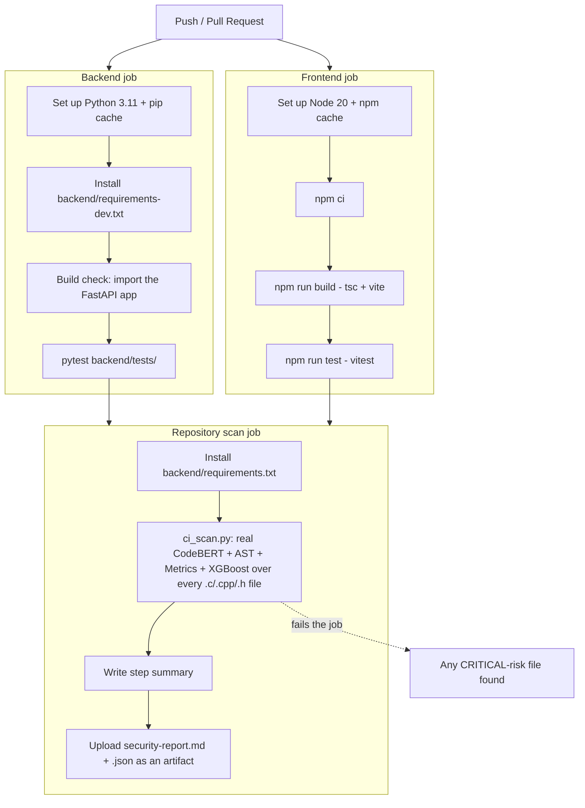

# SecureCode AI — Multi-Modal Code Vulnerability Detection

AI-powered secure code analysis platform combining **AST structural features**,
**software quality metrics**, and **CodeBERT semantic embeddings**, fused into
a single feature vector and classified by trained **XGBoost** / **Random
Forest** models. FastAPI backend, React + Vite frontend. See
`paper/research_paper.md` for the full methodology and evaluation.

- **Run it:** see `DOCKER.md` for the one-command Docker setup, or run
  `backend/` (`uvicorn main:app --reload`) and `frontend/` (`npm run dev`)
  directly against a Python 3.11 venv + Node 20.
- **Architecture:** `app/` holds the original trained ML pipeline
  (AST/metrics/CodeBERT extraction, XGBoost/Random Forest); `backend/` is the
  FastAPI API layer that reuses it (via `ml_bridge.py`) for the live
  platform; `frontend/` is the React dashboard.

---

## CI/CD

Every push and pull request runs the pipeline defined in
[`.github/workflows/ci-cd.yml`](.github/workflows/ci-cd.yml).

### How it works

The backend and frontend are built and tested **in parallel**, since neither
depends on the other. The repository security scan only runs — and can only
pass — if **both** finish successfully first; a broken build is never scanned
or reported as clean.

### Pipeline explanation

| Stage | What it does | Why |
|---|---|---|
| **Backend build check** | `python -c "import main"` | Python has no compiled build step; importing the FastAPI app is the equivalent — it fails loudly on any broken import/router wiring before anything is scanned. |
| **Backend tests** | `pytest backend/tests/` | Real tests: the `/api/health` route responds, every router is registered, AST/metrics feature extraction produces the correct 11/13-dimension vectors the trained models expect, and risk-level thresholds are correct. No test loads CodeBERT (kept fast and deterministic — model-loading behavior is exercised by the scan job instead). |
| **Frontend build** | `npm run build` (`tsc -b && vite build`) | Type-checks and bundles the actual product; this is the exact command a real deployment would run. |
| **Frontend tests** | `npm run test` (`vitest run`) | Real tests against the platform-wide risk-level tables and formatting helpers every dashboard depends on. |
| **Repository scan** | `backend/ci_scan.py` | Runs the same, unmodified prediction pipeline every API endpoint uses (`ml_bridge.run_prediction`) over every `.c/.cpp/.h` file in the repo — no mocking, no separate "CI-only" logic. Fails the job if any file comes back CRITICAL-risk. |
| **Artifacts** | `security-report.md` + `security-report.json` | Uploaded on every run (`if: always()`), even if the scan fails the CRITICAL gate, so the report is inspectable either way. |

### Caching

- Backend: `actions/setup-python`'s built-in `pip` cache, keyed on
  `backend/requirements-dev.txt`.
- Frontend: `actions/setup-node`'s built-in `npm` cache, keyed on
  `frontend/package-lock.json`.

### Demo steps

1. Push a commit (or open a PR) — the workflow starts automatically.
2. Watch the **Backend** and **Frontend** jobs run side by side in the
   Actions tab.
3. Once both succeed, the **Repository scan** job runs and posts a Markdown
   summary directly on the workflow run's summary page.
4. Download the `security-scan-report` artifact for the full
   `security-report.md` / `security-report.json`.
5. To see the failure path, introduce a CRITICAL-risk pattern (e.g. an
   unchecked `strcpy`) into any `.c` file on a branch and open a PR — the
   `repository-scan` job fails and the summary/artifact show exactly why.
