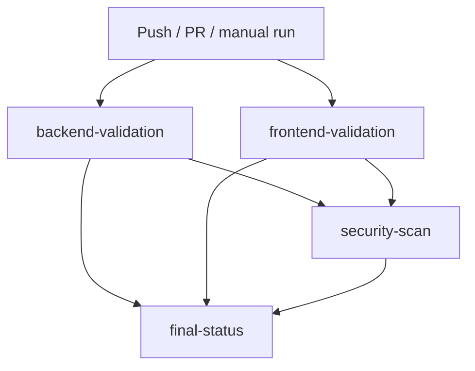

# CI/CD Pipeline

This document explains the GitHub Actions pipeline in
[`.github/workflows/ci-cd.yml`](../.github/workflows/ci-cd.yml) — what it does,
why it's built the way it is, and how to run every check locally before
pushing.

## 1. What CI/CD means in this project

Automated validation on every push and pull request: does the backend still
import cleanly and pass its tests, does the frontend still type-check and
build, and does this project's own AI-assisted vulnerability scanner still run
correctly end-to-end. It is **not** a claim of enterprise-grade production
CI/CD — see [Limitations](#9-limitations-of-this-research-prototype) below.

## 2. When the workflow triggers

- Every `push` to `main` or `master`
- Every `pull_request`
- Manually, via `workflow_dispatch` (the "Run workflow" button in the GitHub
  Actions tab), which also exposes one input: **"Fail the security-scan job
  on CRITICAL findings"**, checked by default. Unchecking it runs the same
  real scan in report-only mode — useful for a guaranteed all-green
  demonstration run alongside the default, stricter behavior.

## 3. What each job does



| Job | Steps | Why |
|---|---|---|
| **backend-validation** | Python syntax check (`compileall`) → import validation (`import main`) → ML model artifact validation → `pytest tests/` | Catches broken imports/syntax before anything downstream runs; explicitly confirms the trained model files are present and loadable (see [§4](#4-how-the-vulnerability-scanner-integrates-into-ci)). |
| **frontend-validation** | `npm ci` → TypeScript check (`tsc -b`) → production build (`vite build`) → `vitest run` | The exact commands a real deployment would run, split into separate steps so a failure is immediately localized (type error vs. bundler error vs. test failure). |
| **security-scan** | *(runs only if both jobs above succeed)* → runs `backend/ci_scan.py`, the same prediction pipeline every API endpoint uses, against `demo/scan_samples/` → writes a step summary → uploads the report as an artifact | See [§4](#4-how-the-vulnerability-scanner-integrates-into-ci) for why it scans a fixture rather than this repo's own source. |
| **final-status** | *(always runs)* Reads the result of all three jobs above and prints one unambiguous pass/fail summary | GitHub Actions already shows per-job status, but a single "Overall: PASSED/FAILED" line is what you want to point to in a live demo. |

`backend-validation` and `frontend-validation` run in parallel (neither
depends on the other). `security-scan` is gated on both succeeding, so a
broken build is never scanned or reported as clean.

## 4. How the vulnerability scanner integrates into CI

`backend/ci_scan.py` is a standalone CLI wrapper around `ml_bridge.run_prediction`
— the identical function every live scan in the running app calls. It is not
a separate "CI-only" reimplementation, and CI does not mock or fake a result.

**Why it scans `demo/scan_samples/` instead of the whole repository:** this
project's own source is Python and TypeScript — it has zero `.c`/`.cpp`/`.h`
files of its own. Pointing the scanner at the repo root would honestly report
"0 files scanned," which validates nothing and makes a poor demo. `demo/scan_samples/`
holds exactly two small, uncommented C snippets that exist for this reason
only (see `demo/scan_samples/README.md`): one deliberately vulnerable
(`strcpy` with no bounds check), one bounds-checked fix. Neither is imported,
compiled, or executed by the platform.

**What the demo fixture actually shows, measured, not assumed (re-measured
after the Phase 4 feature-fusion alignment fix,
`docs/ML_FORENSIC_AUDIT_PHASE4.md` — the model was retrained on corrected
data and the decision threshold was re-selected from 0.32 to 0.26):**

| File | Verdict | Risk Level | Probability |
|---|---|---|---|
| `vulnerable_example.c` | VULNERABLE | LOW RISK | 37.5% |
| `safe_example.c` | VULNERABLE | **CRITICAL** | 97.4% |

This is reported exactly as measured, including the uncomfortable and
genuinely surprising part: **the bounds-checked "safe" version now scores
*higher* risk than the deliberately unsafe one.** This was investigated
directly (not assumed) — it is real, deterministic, explainable model
behavior, not a bug in the retrained model or the fusion fix: the "safe"
example has more structural complexity than the "vulnerable" one (an `if`
guard clause, more AST nodes, higher LOC), and the retrained model has
learned that this kind of structural complexity correlates with vulnerable
code in the Devign training distribution — a correlation that happens to
point the wrong way for these two specific, tiny, synthetic, out-of-
distribution examples. It is an honest reflection of a modest classifier
(XGBoost F1 = 0.5391 on the corrected dataset, see
`docs/ML_ALIGNMENT_FIX_RESULTS.md`) evaluated on inputs very unlike its
real-world (Devign, FFmpeg/QEMU) training data — not a demo built to look
cleaner, or more intuitive, than the model actually is.

## 5. What causes the pipeline to fail

- Any Python syntax error, broken import, missing/unloadable model artifact,
  or failing backend test → **backend-validation** fails.
- Any TypeScript error, build error, or failing frontend test →
  **frontend-validation** fails.
- Any file scanned by `ci_scan.py` at **CRITICAL** risk (the default fail
  policy, passed as `--fail-on CRITICAL`) → **security-scan** fails.
  - **Why CRITICAL only, not HIGH/MEDIUM too:** this is a modest, research-scale
    classifier, not a mature rule engine. Gating on HIGH RISK as well would fail
    the build on the model's own documented false-positive rate rather than on
    high-confidence findings — exactly the "harmless demo file breaks the
    pipeline" failure mode to avoid. The policy is a CLI flag
    (`--fail-on CRITICAL,HIGH RISK`, comma-separated) if you want to tighten it.
- If any of the three jobs above didn't succeed → **final-status** reports
  "Overall: FAILED" and exits non-zero, even though it "always runs."

## 6. How to view security results

1. Open the workflow run in the **Actions** tab.
2. Click the **security-scan** job → its "Write scan summary" step, or the
   run's own **Summary** page, shows the full Markdown report inline
   (files scanned, risk breakdown, top risky files, fail policy).
3. Download the **security-scan-report** artifact for the raw
   `security-report.md` and `security-report.json`.

## 7. How to run the same checks locally

```bash
# Backend
cd backend
pip install -r requirements-dev.txt
python -m compileall -q ../app ../backend ../src
python -c "import main"
pytest tests/ -v

# Frontend
cd frontend
npm ci
npx tsc -b
npx vite build
npm run test

# Security scan (from backend/, against the demo fixture)
python ci_scan.py --path ../demo/scan_samples --output ../security-report
# add --no-fail to see the report without the exit-code gate
```

## 8. How this differs from SonarQube's CI integration

See the full, honest comparison at `/sonarqube-comparison` in the running app
(or `paper/research_paper.md`). For CI specifically: SonarQube integrates as a
mature, first-class GitHub/GitLab/Azure DevOps quality gate with PR
decoration and historical trend tracking across many projects and languages.
This pipeline is a single project's own build+test+scan workflow with no PR
decoration, no cross-project dashboard, and a scanner validated on one
benchmark (Devign, C only) rather than a broad, battle-tested rule set.

## 9. Limitations of this research prototype

- No PR decoration or inline diff comments — findings surface in the Actions
  summary and an artifact, not on the PR itself.
- The security-scan job scans a small fixture, not arbitrary real-world
  repositories at scale (see [§4](#4-how-the-vulnerability-scanner-integrates-into-ci)
  for why, and the earlier-measured 20–70+ second latency on a real 200-file
  repository for why this isn't yet wired up to scan-on-push for a whole
  external codebase).
- The security-scan job's pass/fail signal reflects one classifier's
  measured ~61% accuracy on one benchmark, not a mature, tuned rule engine's
  low false-positive rate — treat a "pass" as "no CRITICAL-confidence
  finding," not as a certification that the scanned code is safe.
- No secrets/credential scanning, license checking, or dependency
  vulnerability scanning (e.g. `npm audit`, `pip-audit`) is wired in — this
  pipeline validates this project's own code and its own vulnerability
  model, nothing broader.
