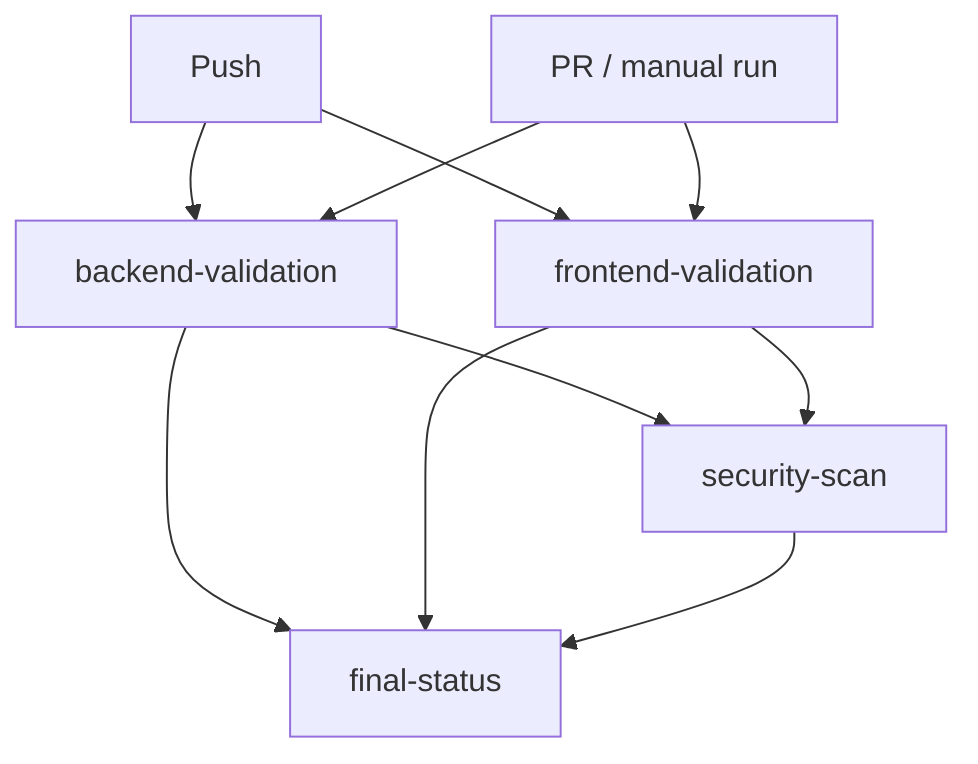

# CI/CD Pipeline

This document explains the GitHub Actions pipeline in
[`.github/workflows/ci-cd.yml`](../.github/workflows/ci-cd.yml) — what it does,
why it's built the way it is, and how to run every check locally before
pushing.

## 1. What CI/CD means in this project

Automated validation on every push and pull request: does the backend still
import cleanly and pass its tests, does the frontend still type-check and
build, and — on a pull request or a manual run — does this project's own
AI-assisted vulnerability scanner flag anything in the code that actually
changed. It is **not** a claim of enterprise-grade production CI/CD — see
[Limitations](#9-limitations-of-this-research-prototype) below.

## 2. When the workflow triggers

- **Every `push`** to `main` or `master` — runs `backend-validation` and
  `frontend-validation` only. **The security-scan job deliberately does
  NOT run on push** — there is no PR diff to scan against, and scanning the
  whole repository on every single push would be slow and, per §4 below,
  would only ever find the same two demo fixtures unless real `.c`/`.cpp`/`.h`
  source exists elsewhere in the repo. This is an honest scope limitation,
  not an oversight: **there is no continuous full-repository scan on every
  push.**
- **Every `pull_request`** — runs all three jobs. `security-scan` scans
  **only the files changed in that PR** (via `git diff` against the PR's
  base commit), not the whole repository.
- **Manually, via `workflow_dispatch`** (the "Run workflow" button in the
  GitHub Actions tab) — runs all three jobs. `security-scan` scans **the
  entire checked-out repository**, exposing one input: **"Fail the job if a
  CRITICAL finding is present"**, unchecked (non-blocking) by default.

## 3. What each job does



| Job | Steps | Why |
|---|---|---|
| **backend-validation** | Python syntax check (`compileall`) → import validation (`import main`) → ML model artifact validation → `pytest tests/` | Catches broken imports/syntax before anything downstream runs; explicitly confirms the trained model files are present and loadable. |
| **frontend-validation** | `npm ci` → TypeScript check (`tsc -b`) → production build (`vite build`) → `vitest run` | The exact commands a real deployment would run, split into separate steps so a failure is immediately localized. |
| **security-scan** | *(pull_request/workflow_dispatch only, and only if both jobs above succeeded)* → computes the file scope (§4) → runs `backend/ci_scan.py` → writes a step summary → uploads SARIF to the Security tab → uploads the raw report as a build artifact → (PR only) posts/updates one PR comment | See [§4](#4-how-the-vulnerability-scanner-integrates-into-ci) for scope, [§6](#6-how-to-view-security-results) for where results show up. |
| **final-status** | *(always runs)* Reads the result of all three jobs above (treating a **skipped** security-scan, i.e. a plain push, as fine) and prints one unambiguous pass/fail summary | GitHub Actions already shows per-job status, but a single "Overall: PASSED/FAILED" line is what you want to point to in a live demo. |

## 4. How the vulnerability scanner integrates into CI

`backend/ci_scan.py` is a standalone CLI wrapper around
`ml_bridge.run_prediction` and `ml_bridge.line_risk_scan` — the identical
functions every live scan in the running app calls. It is not a separate
"CI-only" reimplementation, and CI does not mock or fake a result. This is
the **live, single-function inference path**: AST, software-metrics, and
CodeBERT features are computed directly from each file's own text and
concatenated — there is no cross-file positional join of the kind that
corrupted the *offline training* fusion pipeline (`src/fusion/fuse_features.py`,
now fixed — see `docs/ML_FORENSIC_AUDIT_PHASE4.md` /
`docs/ML_ALIGNMENT_FIX_RESULTS.md`). That bug never applied to CI scanning,
confirmed at the code level, not assumed.

**What gets scanned, and why:**

- **On a pull request:** the workflow computes `git diff --name-only
  --diff-filter=ACMR <base-sha> <head-sha>` (added/copied/modified/renamed
  files only — deleted files aren't scanned, there's nothing left to read),
  writes it to `changed_files.txt`, and passes it to
  `ci_scan.py --files-from changed_files.txt`. Only files with a
  `.c`/`.h`/`.cpp`/`.cc`/`.cxx`/`.hpp` extension are actually scanned; the
  rest are silently filtered out (most PRs to this repo touch Python/TS, so
  a 0-file "no C/C++ changed" result is common and expected, not an error).
- **On a manual run:** `ci_scan.py --path ..` walks the entire checked-out
  repository. This project's own source is Python + TypeScript/React — it
  has no `.c`/`.cpp`/`.h` files of its own outside `demo/scan_samples/`, so a
  full-repo run today finds the same two fixtures a PR run would find if
  they happened to change. `demo/scan_samples/` exists specifically so the
  pipeline always has *something* real to scan and demonstrate (see
  `demo/scan_samples/README.md`) — nothing in it is imported, compiled, or
  executed by the platform.

**Per-file result, exactly as computed (not simulated), against the demo
fixtures right now:**

| File | Verdict | ML Risk Level | ML Probability | Combined Risk (+evidence) | Escalated? |
|---|---|---|---|---|---|
| `vulnerable_example.c` | VULNERABLE | LOW RISK | 37.5% | **CRITICAL** | Yes — `strcpy()` detected (CWE-120) |
| `safe_example.c` | VULNERABLE | **CRITICAL** | 97.4% | CRITICAL | No — ML alone already CRITICAL |

This is reported exactly as measured, including the uncomfortable and
genuinely surprising part: **the bounds-checked "safe" version scores
*higher* by the ML classifier alone than the deliberately unsafe one.**
This was investigated directly (not assumed) — it is real, deterministic,
explainable model behavior: the "safe" example has more structural
complexity than the "vulnerable" one (an `if` guard clause, more AST nodes,
higher LOC), and the model has learned that this kind of structural
complexity correlates with vulnerable code in its training distribution — a
correlation that happens to point the wrong way for these two specific,
tiny, synthetic, out-of-distribution examples. It is an honest reflection
of a modest classifier (XGBoost F1 = 0.5391 on the corrected dataset, see
`docs/ML_ALIGNMENT_FIX_RESULTS.md`), not a demo built to look cleaner than
the model actually is. **This is also exactly why `ci_scan.py` combines the
ML verdict with a separate, deterministic, rule-based evidence layer
(`ml_bridge.line_risk_scan`, CWE-tagged pattern matching)** rather than
reporting the ML score alone: the evidence layer correctly flags
`vulnerable_example.c`'s unguarded `strcpy()` regardless of what the ML
model alone said, and can only ever *escalate* the reported risk, never
suppress the ML model's own signal (`ml_bridge.evidence_based_risk`).

**Model mode is always labeled, never blurred.** Every finding carries a
`model_mode` field: `"trained"` when the real `models/xgboost.json` /
`models/random_forest.joblib` loaded successfully, `"fallback"` when they
didn't and the heuristic demo predictor ran instead. The scan summary and
PR comment surface this explicitly rather than presenting a fallback result
as if it came from the trained model.

**The ML baseline status shown in the report is never hand-typed.**
`ci_scan.py` reads `models/ml_baseline_status.json` — a small, committed,
manually-maintained record of whether the fusion-alignment fix (§ above) is
applied and what the current decision threshold is — and includes it
verbatim in the JSON/Markdown/PR-comment output. It is not a string baked
into the workflow YAML, so it can't silently drift out of sync with that
file (it *can* still go stale if that file itself isn't updated when the
baseline changes — see that file's own `maintained_by` field).

## 5. Blocking vs. non-blocking (`SCAN_BLOCKING`)

**Non-blocking by default.** The security-scan job's exit code is a signal,
not a gate, until this is deliberately turned on:

- Set the repository variable `SCAN_BLOCKING` to `true` (Settings → Secrets
  and variables → Actions → Variables) to make **pull_request** runs
  blocking.
- Or, for a one-off manual run, check "Fail the job if a CRITICAL finding is
  present" when triggering `workflow_dispatch`.
- Either way, only `CRITICAL`-level combined findings fail the job (`--fail-on
  CRITICAL`, a `ci_scan.py` flag) — **why CRITICAL only, not HIGH/MEDIUM
  too:** this is a modest, research-scale classifier, not a mature rule
  engine. Gating on HIGH RISK as well would fail the build on the model's
  own documented false-positive rate rather than on high-confidence
  findings.

This was a deliberate default flip from an earlier version of this
pipeline, which defaulted to blocking on CRITICAL. It is intentionally
non-blocking **while the ML baseline status is anything other than fully
revalidated end-to-end in production use** — flip `SCAN_BLOCKING` to `true`
once you're confident the model's false-positive rate is acceptable for
your workflow, not before.

## 6. How to view security results

1. **GitHub Security tab** (`Security → Code scanning`) — every finding is
   uploaded as SARIF (`github/codeql-action/upload-sarif`), so it appears
   natively alongside any other code-scanning tool, with file/line
   locations and CWE-based rule IDs.
2. **The PR itself** — one comment (created once, then updated in place on
   every subsequent run of the same PR, not duplicated) summarizing files
   scanned, severity breakdown, model mode, and the ML baseline status
   line.
3. **The workflow run's Summary page** — the security-scan job's "Write
   scan summary" step renders the full Markdown report inline.
4. **The `security-scan-report` build artifact** — the raw
   `security-report.md`, `security-report.json`, and `security-report.sarif`.

## 7. How to run the same checks locally

```bash
# Backend
cd backend
pip install -r requirements-dev.txt
python -m compileall -q ../app ../backend ../src
python -c "import main"
pytest tests/ -v

# Frontend
cd frontend
npm ci
npx tsc -b
npx vite build
npm run test

# Security scan -- demo fixtures (what a manual full-repo run would find today)
cd backend
python ci_scan.py --path ../demo/scan_samples --output ../security-report

# Security scan -- simulate a PR's changed-files scan
git diff --name-only --diff-filter=ACMR origin/main HEAD > ../changed_files.txt
python ci_scan.py --files-from ../changed_files.txt --path .. --output ../security-report

# Add SCAN_BLOCKING=true (env var) to make a non-zero exit code on a
# CRITICAL finding; omit it (or leave it unset/false) to always exit 0.
```

## 8. How this differs from SonarQube's CI integration

See the full, honest comparison at `/sonarqube-comparison` in the running app
(or `paper/research_paper.md`). For CI specifically: SonarQube integrates as a
mature, first-class GitHub/GitLab/Azure DevOps quality gate with PR
decoration and historical trend tracking across many projects and languages.
This pipeline is a single project's own build+test+scan workflow, with PR
decoration limited to one summary comment (no inline diff annotations) and a
scanner validated on one benchmark (Devign, C only) rather than a broad,
battle-tested rule set.

## 9. Limitations of this research prototype

- **No continuous full-repository scan on every push** — only on a pull
  request (changed files) or a manual `workflow_dispatch` run (full repo).
  A vulnerability introduced and merged outside a PR (e.g. a direct push to
  `main`) will not be caught by this pipeline until the next manual run.
- **No inline diff annotations** — PR feedback is one summary comment plus
  the Security tab, not a comment on the specific changed line (SARIF
  upload does carry file/line locations into the Security tab itself,
  which does support that view).
- The security-scan job's signal reflects one classifier's measured ~54%
  F1 on one benchmark (Devign) plus a separate deterministic pattern
  scanner, not a mature, tuned rule engine's low false-positive rate —
  treat a finding as "worth a human look," not as a certification that the
  scanned code is unsafe, and treat a clean result as "nothing this
  specific pipeline caught," not as "this code is safe" (see §4's
  documented case where the ML component alone got a synthetic example
  backwards).
- This project's own source (Python/TypeScript) is not itself scanned by
  this pipeline — it only scans `.c`/`.h`/`.cpp`/`.cc`/`.cxx`/`.hpp` files,
  because that's the language the trained model understands. `sonar-project.properties`
  in this repo covers the Python/TypeScript side via a separate, unrelated
  SonarQube integration.
- No secrets/credential scanning, license checking, or dependency
  vulnerability scanning (e.g. `npm audit`, `pip-audit`) is wired in — this
  pipeline validates this project's own code and its own vulnerability
  model, nothing broader.
